# `anikett77@github`

Building things. Learning every day. Shipping projects.

 

### `anikett77@github ~ $ ./contributions.sh`

  

### `anikett77@github ~ $ whoami`

<table>
  <tr>
    <td valign="top">
      
    </td>

    <td valign="top">
      
    </td>
  </tr>
</table>

 

### `anikett77@github ~ $ echo "Thanks for visiting!"`

Made with Python, SVG, and GitHub Actions.

